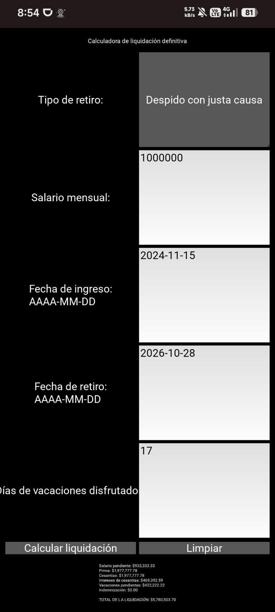

# Proyecto de Liquidación Definitiva

## 📖 Descripción

Este proyecto consiste en el desarrollo de una calculadora que permite calcular la **liquidación definitiva de un empleado** de acuerdo con el motivo de finalización del contrato.

El programa automatiza el cálculo de las prestaciones sociales, la indemnización cuando corresponda y el valor total de la liquidación, a partir de la información suministrada del empleado.

El objetivo es reducir errores en los cálculos manuales y facilitar la obtención de una liquidación a partir de la información suministrada.

Las liquidaciones se guardan en PostgreSQL mediante SQLAlchemy y pueden consultarse posteriormente por documento del empleado o por ID.

---

## 🗂️ Estructura del proyecto

El proyecto sigue el patrón MVC: el modelo contiene las entidades y la lógica de liquidación; el controlador coordina las operaciones y registra las rutas web mediante Blueprints de Flask; las vistas ofrecen interfaces web y de consola; y `tests` contiene las pruebas unitarias.

```text
liquidacion-definitiva/
├── doc/
├── sql/
│   └── schema.sql
├── src/
│   ├── controller/
│   │   ├── aplicacion.py
│   │   ├── liquidacion_controller.py
│   │   └── blueprints/
│   ├── model/
│   │   ├── base_datos.py
│   │   ├── entidades.py
│   │   ├── excepciones.py
│   │   └── logica_liquidacion.py
│   ├── view/
│   │   ├── gui/
│   │   ├── main.py
│   │   ├── web/
│   │   │   ├── app.py
│   │   │   └── templates/
│   │   └── web_estilizada/
│   │       ├── app.py
│   │       ├── static/
│   │       └── templates/
│   ├── secret_config_sample.py
│   └── verificar_conexion.py
├── tests/
│   ├── test_base_datos.py
│   ├── test_configuracion.py
│   └── test_liquidacion.py
├── .env.example
├── .gitignore
├── README.md
├── requirements-web.txt
├── requirements.txt
└── Liquidacion definitiva.xlsx
```

### Responsabilidad de cada componente

| Archivo o carpeta | Responsabilidad |
| --- | --- |
| `src/model/logica_liquidacion.py` | Contiene las funciones y reglas para calcular los conceptos de la liquidación. |
| `src/model/entidades.py` | Define las entidades `Empleado` y `Liquidacion`, que SQLAlchemy relaciona con las tablas de la base de datos. |
| `src/model/base_datos.py` | Lee la configuración de conexión y crea el motor de conexión a PostgreSQL. |
| `src/model/excepciones.py` | Define errores propios para informar problemas de datos, conexión y consultas. |
| `src/controller/liquidacion_controller.py` | Coordina la lógica de liquidación con las operaciones de la base de datos. |
| `src/controller/aplicacion.py` | Configura Flask, registra filtros de presentación y conecta la aplicación con sus rutas. |
| `src/controller/blueprints/` | Organiza las rutas web por funcionalidad: inicio, liquidaciones, búsqueda y base de datos. |
| `src/view/web_estilizada/` | Versión web con estilos CSS y plantillas HTML. |
| `src/view/web_estilizada/app.py` | Inicia la versión web con el diseño visual de la aplicación. |
| `src/view/web_estilizada/templates/` | Contiene las plantillas HTML que muestran las páginas de la aplicación. |
| `src/view/web_estilizada/static/` | Contiene recursos estáticos, como la hoja de estilos CSS. |
| `src/view/main.py` | Interfaz de consola para calcular, guardar y buscar liquidaciones. |
| `src/view/web/` | Versión web sencilla, con plantillas HTML. |
| `tests/` | Contiene las pruebas unitarias de los cálculos, validaciones y operaciones de base de datos. |
| `sql/schema.sql` | Archivo SQL de apoyo con instrucciones para crear o borrar tablas y ejemplos de consultas. |
| `src/verificar_conexion.py` | Comprueba la configuración y la conexión con PostgreSQL. |
| `.env.example` | Plantilla con los nombres de las variables necesarias para configurar la conexión. |
| `Liquidacion definitiva.xlsx` | Tablero de casos de prueba utilizado como apoyo para verificar los resultados. |

---

## 🏗️ Arquitectura

El proyecto utiliza una separación por responsabilidades:

### Model

Contiene la lógica de negocio de la aplicación.

`logica_liquidacion.py` contiene funciones independientes para:

* Calcular días trabajados.
* Calcular salario restante.
* Calcular prima.
* Calcular cesantías.
* Calcular intereses sobre las cesantías.
* Calcular vacaciones.
* Calcular indemnización.
* Calcular la liquidación total.

`entidades.py` contiene las clases del ORM:

* `Empleado` → tabla `empleados` (`id`, `documento` único, `nombre`).
* `Liquidacion` → tabla `liquidaciones` (datos de entrada, cada concepto calculado, `total` y fecha de creación). Cada liquidación pertenece a un empleado y un empleado puede tener varias.

`excepciones.py` contiene las excepciones personalizadas:

* `FechaInvalidaError`
* `SalarioInvalidoError`
* `TipoRetiroInvalidoError`
* `VacacionesInvalidasError`
* `DocumentoInvalidoError`, `NombreInvalidoError`
* `EmpleadoNoEncontradoError`, `LiquidacionNoEncontradaError`
* `ConfiguracionBDError`, `ErrorConexionBDError`, `TablasNoCreadasError`
* `DocumentoInvalidoError`, `NombreInvalidoError`
* `EmpleadoNoEncontradoError`, `LiquidacionNoEncontradaError`
* `ConfiguracionBDError`, `ErrorConexionBDError`, `TablasNoCreadasError`

Las excepciones se mantienen separadas de la lógica de negocio para mejorar la organización y el mantenimiento del código.

### View

La carpeta `src/view/` contiene las interfaces del sistema: una versión de consola en `main.py`, una aplicación web sencilla en `web/` y una versión web con estilos en `web_estilizada/`.

### Controller

`LiquidacionController` coordina la lógica de negocio con la base de datos:

* `crear_tablas()` y `borrar_tablas()`.
* `registrar_liquidacion()` → calcula y guarda (`INSERT INTO`).
* `buscar_por_documento()` y `buscar_por_id()` → consultas (`SELECT`).
* `listar_liquidaciones()`, `buscar_por_tipo_retiro()` y `listar_empleados()` → listados y filtros.
* `obtener_total_liquidado()` → suma de las liquidaciones de un empleado.
* `actualizar_nombre_empleado()` → `UPDATE`.
* `eliminar_liquidacion()` y `eliminar_empleado()` → `DELETE`.

Convierte los errores técnicos de la base de datos (sin conexión, tablas inexistentes) en excepciones propias con mensajes claros.

* `crear_tablas()` y `borrar_tablas()`.
* `registrar_liquidacion()` → calcula y guarda (`INSERT INTO`).
* `buscar_por_documento()` y `buscar_por_id()` → consultas (`SELECT`).
* `listar_liquidaciones()`, `buscar_por_tipo_retiro()` y `listar_empleados()` → listados y filtros.
* `obtener_total_liquidado()` → suma de las liquidaciones de un empleado.
* `actualizar_nombre_empleado()` → `UPDATE`.
* `eliminar_liquidacion()` y `eliminar_empleado()` → `DELETE`.

Convierte los errores técnicos de la base de datos (sin conexión, tablas inexistentes) en excepciones propias con mensajes claros.

### Tests

La carpeta `tests` contiene las pruebas unitarias que permiten verificar el comportamiento esperado del sistema.

---

# 🗄️ Base de datos PostgreSQL

La aplicación utiliza PostgreSQL para guardar empleados y liquidaciones. En este proyecto, la base de datos está alojada en Neon.

## 1. Crear las bases de datos en Neon

En el proyecto de Neon deben existir dos bases de datos:

- `neondb`: base de datos principal de la aplicación.
- `neondb_test`: base de datos exclusiva para las pruebas unitarias.

Las pruebas pueden borrar y volver a crear tablas. Por eso, `DB_NAME_TEST` debe apuntar siempre a la base de pruebas y nunca a la base principal.

## 2. Configurar la conexión

El proyecto lee la conexión desde el archivo `.env`, ubicado en la carpeta raíz. Este archivo contiene contraseñas y no se sube a GitHub.

Copia el archivo de ejemplo:

```bash
cp .env.example .env
```

En Windows, usa:

```powershell
copy .env.example .env
```

Abre `.env` y completa los datos que aparecen en Neon, en la opción **Connect**:

| Variable | Valor |
| --- | --- |
| `DB_USER` | Usuario de PostgreSQL que muestra Neon. |
| `DB_PASSWORD` | Contraseña de ese usuario. |
| `DB_HOST` | Host de Neon, sin `https://` ni otras partes de la cadena de conexión. |
| `DB_PORT` | Puerto de PostgreSQL, normalmente `5432`. |
| `DB_NAME` | `neondb`, para usar la base principal. |
| `DB_NAME_TEST` | `neondb_test`, para que las pruebas usen la base separada. |
| `DB_SSLMODE` | `require`, para conectar con Neon mediante SSL. |

No compartas ni publiques el contenido de `.env`.

## 3. Verificar la conexión

Desde la carpeta raíz del proyecto, ejecuta:

```bash
python src/verificar_conexion.py
```

El programa comprueba la conexión con la base principal y con la base de pruebas. No muestra la contraseña.

## 4. Crear las tablas desde la aplicación web

Inicia la aplicación web siguiendo los pasos de la sección **Ejecutar la aplicación web**. En la página, abre **Base de datos** y pulsa **Crear tablas**.

Esta opción crea las tablas que falten y conserva los datos existentes. No elimina las liquidaciones guardadas.

La base de datos contiene estas tablas:

| Tabla | Propósito |
| --- | --- |
| `empleados` | Guarda el documento y el nombre de cada empleado. |
| `liquidaciones` | Guarda los datos de cada liquidación y los valores calculados. Cada registro se relaciona con un empleado. |

# ▶️ Cómo ejecutar

## Ejecutar las aplicaciones web

### 1. Instalar dependencias web

Desde la carpeta raíz del proyecto, ejecuta:

```bash
pip install -r requirements-web.txt
```

### 2. Configurar la conexión y la clave de Flask

Configura el archivo `.env` como se explica en la sección **Base de datos PostgreSQL**.

En Linux, macOS o Codespaces, genera la clave de Flask con:

```bash
export FLASK_SECRET_KEY="$(python -c 'import secrets; print(secrets.token_hex(32))')"
```

En Windows PowerShell:

```powershell
$env:FLASK_SECRET_KEY = python -c "import secrets; print(secrets.token_hex(32))"
```

### 3. Ejecutar la versión HTML sencilla

Desde la carpeta raíz, ejecuta:

```bash
python src/view/web/app.py
```

Abre `http://127.0.0.1:5000` en el navegador. Para iniciar la otra versión, detén primero esta con `Ctrl+C`.

### 4. Ejecutar la versión con estilo

Desde la carpeta raíz, ejecuta:

```bash
python src/view/web_estilizada/app.py
```

Abre `http://127.0.0.1:5000` en el navegador.

En GitHub Codespaces, usa la pestaña **Ports** y abre el enlace del puerto `5000`.

### Aplicaciones publicadas

- [Versión HTML sencilla](https://liquidacion-definitiva-html.onrender.com)
- [Versión con estilo](https://liquidacion-definitiva-tfe4.onrender.com)

Las dos versiones usan la misma base de datos Neon y comparten los registros.

## Calcular, guardar y buscar liquidaciones por consola

Con la base de datos configurada (secciones anteriores), desde la carpeta raíz ejecutar:

```bash
python src/view/main.py
```

Se muestra un menú:

1. **Calcular y guardar una liquidación** (pide documento, nombre y los datos del retiro).
2. **Buscar liquidaciones por documento.**
3. **Buscar una liquidación por id.**
4. **Crear las tablas.**
5. **Borrar las tablas** (pide confirmación).

## Ejecutar las pruebas unitarias

Requieren que `DB_NAME_TEST` exista y esté configurada (en `.env` o `src/secret_config.py`). Desde la carpeta raíz ejecutar:

```bash
python -m unittest tests.test_liquidacion tests.test_base_datos tests.test_configuracion -v
```

También se pueden ejecutar todas las pruebas mediante descubrimiento automático:

```bash
python -m unittest discover -s tests -p "test_*.py" -v
```

---

## 📥 Entradas

El usuario debe ingresar la siguiente información a través de `main.py`:

* Tipo de retiro.
* Salario mensual.
* Fecha de ingreso (`AAAA-MM-DD`).
* Fecha de retiro (`AAAA-MM-DD`).
* Días de vacaciones ya disfrutados.

## Tipos de retiro soportados

* `Renuncia`
* `Despido con justa causa`
* `Despido sin justa causa`

En los casos de `Renuncia` y `Despido con justa causa` no se calcula indemnización.

En el caso de `Despido sin justa causa` se calcula la indemnización correspondiente.

---

## ⚙️ Proceso

Una vez ingresada la información, el sistema realiza las siguientes operaciones:

1. **Valida el salario**: debe ser mayor que cero. En caso contrario se genera `SalarioInvalidoError`.

2. **Valida las fechas**: la fecha de retiro no puede ser anterior a la fecha de ingreso. En caso contrario se genera `FechaInvalidaError`.

3. **Valida los días de vacaciones disfrutadas**: no pueden ser negativos. En caso contrario se genera `VacacionesInvalidasError`.

4. **Calcula los días trabajados** entre la fecha de ingreso y la fecha de retiro.

5. **Calcula el salario restante** correspondiente al último período trabajado.

6. **Calcula las prestaciones sociales**:

   * Salario restante.
   * Prima de servicios.
   * Cesantías.
   * Intereses sobre las cesantías.
   * Vacaciones pendientes.

7. **Calcula la indemnización** según el tipo de retiro. La indemnización se genera únicamente para `Despido sin justa causa`.

8. **Valida el tipo de retiro**. Si no corresponde a uno de los tipos soportados, se genera `TipoRetiroInvalidoError`.

9. **Suma todos los conceptos** para obtener el valor total de la liquidación.

10. **Muestra el resultado o el mensaje de error correspondiente** en la interfaz de consola.

---

## 📤 Salidas

El sistema genera como resultado:

* Valor del salario restante.
* Valor de la prima.
* Valor de las cesantías.
* Valor de los intereses sobre las cesantías.
* Valor de las vacaciones pendientes.
* Valor de la indemnización cuando corresponda.
* Valor total de la liquidación.
* Mensajes de error específicos cuando los datos suministrados no son válidos.

---

# 🧪 Casos de prueba

Las pruebas unitarias se encuentran en:

```text
tests/test_liquidacion.py
```

Las pruebas utilizan la biblioteca `unittest` de Python.

Se verifican diferentes componentes de la lógica de liquidación, incluyendo cálculos, validaciones, excepciones y liquidaciones completas.

### Casos normales

Entre los casos probados se encuentran:

* Cálculo de días trabajados.
* Cálculo de salario restante.
* Cálculo de prima.
* Cálculo de cesantías.
* Cálculo de intereses sobre cesantías.
* Cálculo de vacaciones generadas.
* Cálculo de vacaciones disfrutadas.
* Cálculo de vacaciones pendientes.
* Cálculo de indemnización.
* Cálculo de días de indemnización.
* Cálculo de indemnización según el tipo de retiro.
* Liquidación completa por renuncia.
* Liquidación completa por despido sin justa causa.
* Suma de los conceptos de liquidación.

### Pruebas de base de datos (`tests/test_base_datos.py`)

Usan los *test fixtures* `setUp` / `tearDown`, que borran y crean las tablas en `DB_NAME_TEST` antes y después de cada prueba, dejando siempre la base limpia. Cubren, con al menos un caso normal y uno de error por funcionalidad:

* **Crear tablas**: se crean `empleados` y `liquidaciones`; ejecutar dos veces no falla; sin conexión → `ErrorConexionBDError`.
* **Borrar tablas**: desaparecen tablas y datos; sin conexión → `ErrorConexionBDError`.
* **Insertar**: guarda liquidación, conceptos y total; reutiliza al empleado si el documento ya existe; salario inválido, fecha inválida, documento vacío o con símbolos, nombre vacío o sin conexión → error y no se guarda nada.
* **Buscar**: por documento (varias liquidaciones) y por id; documento inexistente → `EmpleadoNoEncontradoError`, id inexistente → `LiquidacionNoEncontradaError`, sin tablas → `TablasNoCreadasError`.

### Casos de error

Las pruebas también verifican:

* Salario negativo → `SalarioInvalidoError`.
* Salario igual a cero → `SalarioInvalidoError`.
* Fecha de retiro anterior a la fecha de ingreso → `FechaInvalidaError`.
* Días de vacaciones disfrutadas negativos → `VacacionesInvalidasError`.
* Tipo de retiro no soportado → `TipoRetiroInvalidoError`.

Para ejecutar las pruebas:

```bash
python -m unittest tests.test_liquidacion tests.test_base_datos tests.test_configuracion -v
```

---

# 📊 Casos de prueba en Excel

Además de las pruebas unitarias en Python, el proyecto incluye un archivo de Excel utilizado como apoyo para la verificación manual de los cálculos:

```text
Liquidacion definitiva.xlsx
```

El archivo permite comparar diferentes escenarios de liquidación y verificar visualmente los resultados obtenidos.

### Casos normales

Se contemplan escenarios como:

* Despido con justa causa.
* Renuncia voluntaria.
* Despido sin justa causa.

En estos escenarios se verifican los diferentes conceptos que componen la liquidación y la aplicación de la indemnización según corresponda.

### Casos excepcionales

Se contemplan escenarios con diferentes condiciones de entrada, como:

* Salario alto.
* Salario bajo.
* Vacaciones agotadas.
* Diferentes condiciones para los intereses de cesantías.

Estos casos permiten comprobar el comportamiento del sistema ante valores que se encuentran fuera de los escenarios habituales.

### Casos de error

Se contemplan casos como:

* Salario en cero.
* Salario negativo.
* Fecha de retiro anterior a la fecha de ingreso.
* Días de vacaciones negativos.
* Datos inválidos.

El objetivo es verificar que el sistema rechace los datos incorrectos y genere el error correspondiente en lugar de producir una liquidación incorrecta.

---

# 🛠️ Tecnologías utilizadas

* **Python 3.12**
* * **PostgreSQL** alojado en **Neon** — base de datos.
* **SQLAlchemy 2** (ORM) y **psycopg2** — acceso a la base de datos.
* **python-dotenv** — lectura del archivo `.env`.
* **unittest** — pruebas unitarias.
* **Microsoft Excel** — tablero de verificación manual de casos de prueba.
* **Visual Studio Code** — entorno de desarrollo.

---

# 🧹 Principios de calidad de código

El proyecto busca aplicar principios de **Clean Code** y buenas prácticas de desarrollo:

* Funciones pequeñas y con una responsabilidad específica.
* Nombres descriptivos.
* Separación de responsabilidades.
* Constantes para valores utilizados en los cálculos.
* Excepciones personalizadas.
* Separación de excepciones y lógica de negocio.
* Separación entre modelo, vista, controlador y pruebas.
* Evitar duplicación de código.
* Documentación mediante docstrings.
* Código orientado a facilitar el mantenimiento y las pruebas.

---

# 👥 Integrantes

| Nombre       | GitHub                                           |
| ------------ | ------------------------------------------------ |
| Jhoan Ríos   | [@jhoan-rios](https://github.com/jhoan-rios)     |
| Andrés Rosas | [@andres-rosas](https://github.com/andres-rosas) |

---

# 📌 Estado del proyecto

Proyecto desarrollado como parte de las prácticas de programación, con evolución progresiva de la estructura, arquitectura, pruebas unitarias y calidad del código.

La versión actual incorpora una separación de responsabilidades entre la lógica de negocio, las excepciones, la interfaz de consola y las pruebas unitarias.

## 📱 Aplicación Android

La aplicación fue compilada con Buildozer desde Ubuntu 22.04
mediante WSL, instalada y ejecutada en un dispositivo Android.

### Descarga de ejecutables

El APK de Android y el ejecutable de Windows se publican en:

https://github.com/Jose-Dv/liquidacion-definitiva/releases

### Instalación en Android

1. Descargar `liquidaciondefinitiva-0.1-arm64-v8a-debug.apk`.
2. Transferir el archivo al dispositivo Android.
3. Abrir el APK y, si se solicita, permitir la instalación desde
   la aplicación utilizada para abrirlo.
4. Completar la instalación.
5. Abrir **Liquidacion Definitiva**.

El APK es una compilación de prueba (`debug`) para dispositivos
con arquitectura ARM64 y Android 7.0 o posterior.

### Entorno de compilación utilizado

| Componente | Configuración |
|---|---|
| Sistema de compilación | Ubuntu 22.04 mediante WSL |
| Buildozer | 1.6.0 |
| Java | OpenJDK 17 |
| Python para Android | 3.13.5 |
| Hostpython | 3.13.5 |
| Interfaz gráfica | Kivy |
| Arquitectura | arm64-v8a |
| API mínima de Android | 24 |
| API objetivo de Android | 33 |

La configuración se encuentra en `buildozer.spec`.

### Ajustes necesarios durante la compilación

Se modificó el archivo `pythonforandroid/build.py` de la copia
local de python-for-android utilizada por Buildozer:

1. Se limitó la actualización interna de pip a versiones menores
   de 26. Este cambio por sí solo no resolvió el error.
2. Se indicó explícitamente la plataforma Android en el comando
   que instala los paquetes de `requirements.txt` en el directorio
   de destino, agregando estas opciones:

```text
--platform android_24_arm64_v8a --python-version 3.13 --implementation cp --only-binary=:all:
```

Después de este ajuste, la compilación terminó correctamente.

Los archivos que documentan el entorno son:

- `buildozer.spec`: configuración de la aplicación Android.
- `doc/android/p4a-build.patch`: cambios aplicados a python-for-android.
- `doc/android/p4a-commit.txt`: revisión exacta de python-for-android utilizada.

Estos ajustes corresponden a la configuración indicada y deben
revisarse si se cambia la versión de Python o la arquitectura.

### Generación del APK

La compilación se realiza desde Ubuntu, con el proyecto ubicado
en el sistema de archivos de Linux, por ejemplo:

```bash
cd ~/liquidacion-definitiva
```

Para reproducir el entorno es necesario instalar las herramientas
de compilación, utilizar la revisión de python-for-android
registrada en `doc/android/p4a-commit.txt` y aplicar el parche
`doc/android/p4a-build.patch` desde la raíz de esa copia de
python-for-android.

Con el entorno preparado, ejecutar:

```bash
buildozer -v android debug
```

El archivo generado queda en:

```text
bin/liquidaciondefinitiva-0.1-arm64-v8a-debug.apk
```

### Evidencia de ejecución en Android


